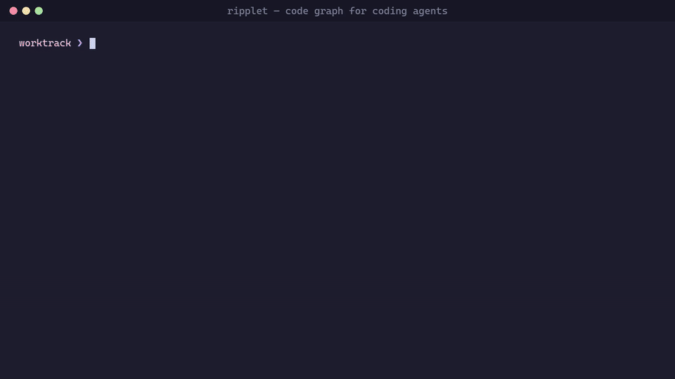

<p align="center">
  
</p>

<h1 align="center">Ripplet</h1>

<p align="center">
  <b>A change guard and refactoring engine for coding agents.</b><br>
  Catches what an agent broke. Does the multi-file edits it gets wrong.
</p>

<p align="center">
  <a href="https://pypi.org/project/ripplet/"></a>
  
  
  
  <a href="https://buymeacoffee.com/neush4"></a>
</p>

<p align="center">
  <a href="#what-it-does">What it does</a> ·
  <a href="#results">Results</a> ·
  <a href="#use-it">Use it</a> ·
  <a href="#languages">Languages</a> ·
  <a href="#license">License</a>
</p>

<p align="center">
  
</p>

---

Coding agents break working code in places they never opened: a caller of a
function whose signature changed, a query on a column a migration dropped, an
import after a file move. Ripplet checks this with a local code graph, with no
LLM guessing, and gives the agent tools that make these edits in one call.
Every answer has `file:line`; a link the graph cannot prove is labelled, not guessed.

```bash
pip install "ripplet[treesitter-multilang]"
ripplet setup .        # index + MCP config + agent rules, hooks and change guard, in one step
```

## What it does

**1. Guards the change.** When the agent finishes, a hook runs `check_change`
and sends it back if it left something behind:

- callers of a function whose signature changed
- places still using what the edit replaced or removed
- code using a table or column a migration dropped
- frontend calls to an endpoint that changed
- architecture rules broken (`ripplet.arch.yaml`)
- the exact tests that reach the change

The same check reviews a PR (`ripplet review`, Markdown or SARIF for GitHub Code Scanning).

**2. Makes the multi-file edits.** Atomic, checked against the graph, and
refused (nothing written) when it cannot prove the edit is safe:

- `rename_symbol`: declaration, overrides, every call site and import
- `change_signature`: add, remove or reorder parameters at every call site
- `move_symbol`: a function, class or type to another file or package, imports and
  namespaces fixed, in 14 languages ([how each is checked](docs/move_symbol.md))

**3. Answers code questions with proof.** Who calls this, what breaks if it
changes, which files a task touches, which routes lack a permission check,
which queries use a column. A precise graph of calls, types, routes and SQL,
checked against compiler indexes: 0 wrong edges in 12 repositories.

**Local.** One SQLite file, no LLM, no cloud. Python 3.12+.

## Results

Measured on real open-source repositories, same harness for every tool.
Ripplet is compared with Graphify 0.9.92 (defaults).

| | Ripplet | Graphify |
|---|---:|---:|
| Callers found (call-site recall, 258 functions, 9 languages) | **~93%** | ~23% |
| Right file first for a task (hit@1, 389 real commits, 13 repos) | **63.0%** | 44.5% |
| Broken change caught by the selected tests (click, conduit) | **68-92%** | 10-20% |
| Wrong call edges vs a compiler (12 repos, 77,907 call sites) | **0** | not measured |

With a coding agent (Claude Haiku 4.5, headless, one run each, with vs without Ripplet):

| Task | With | Without |
|---|---|---|
| Rename a function everywhere, 13 repos in 13 languages (complete and compiles) | **13/13, $0.81, 85 turns** | 12/13, $1.82, 420 turns |
| Add a parameter, 4 repos (70 call sites) | **$0.20, 15 turns** | $1.42, 159 turns |
| Move a function to a new module (requests, Python) | **$0.09, 11 turns** | $0.23, 28 turns |
| Move a function to a new package (gin, Go) | **$0.08, 10 turns** | $0.23, 34 turns |

The gain is in changes. Exploring and building cost about the same with or
without Ripplet (five "add a feature" tasks: $1.00 vs $1.10, inside the noise).
Single runs: read them as a direction. Every `move_symbol` language was also
compiled or run on sampled symbols; across all of them none of the moves that were made broke the build ([details](docs/move_symbol.md)).

<details>
<summary>Per-language caller recall, task-localisation and compiler-precision tables</summary>

**Callers (site recall, share of real call sites found):**

| Set | Functions | Ripplet | Graphify |
|---|---:|---:|---:|
| fresh (13 repos: TS, Java, C#, Go, PHP, Python, Rust, Lua) | 150 | **93%** | 23% |
| dev (7 repos: Java, Lua, Python, TS, C#) | 67 | **96%** | 29% |
| extra (9 repos: Lua, Ruby, Rust) | 41 | **89%** | 16% |

Java 99% vs 66%, TypeScript 91% vs 14%, Python 96% vs 29%, Go 98% vs 48%, C# 93% vs 11%,
Lua 94% vs 6%, Rust 90% vs 56%, Ruby 86% vs 25%, PHP 100% vs 79%.

**Where a task should be done** (`task_context` vs `graphify query`; the commit subject is the task, the files it changed are the answer; hit@5 83.8% vs 69.9%):

| Repository | Tasks | hit@1 Ripplet | hit@1 Graphify |
|---|---:|---:|---:|
| httpx (Python) | 38 | **53%** | 34% |
| marshmallow (Python) | 29 | **76%** | 41% |
| jsoup (Java) | 40 | **60%** | 30% |
| chi (Go) | 40 | **62%** | 50% |
| attrs (Python) | 15 | **80%** | 33% |
| zustand (TypeScript) | 11 | 91% | 91% |
| gson (Java) | 39 | **46%** | 36% |
| cobra (Go) | 40 | **82%** | 52% |
| monolog (PHP) | 40 | **68%** | 55% |
| javapoet (Java) | 37 | 70% | 70% |
| commons-text (Java) | 18 | **78%** | 72% |
| commons-csv (Java) | 7 | **71%** | 14% |
| JsonPath (Java) | 35 | **26%** | 11% |

**Test selection** (mutants caught by the selected tests, Ripplet / Graphify / grep): click 68% / 10% / 30%, conduit 92% / 20% / 52%.
Ripplet selects more tests (43% of click's suite, 16% of conduit's).

**Precision against SCIP compiler indexes** (recall, wrong edges): hono 0.955, h3 0.986, axios 1.000,
starlette 0.964, requests 0.974, ripgrep 0.938, axum 0.852, eShopOnWeb 0.920, gin 0.959, echo 0.940,
spring-petclinic 0.962, commons-lang 0.905. All 12: **0.925** of 77,907 call sites, **0** wrong edges.
A call Ripplet cannot prove (an untyped receiver whose method name exists in the project) is not
turned into an edge; agents see it in an `UNVERIFIED` section.

</details>

## Use it

```bash
ripplet setup .                 # init, index, .mcp.json / opencode.json, rules, skill, hooks, guard
ripplet check . --run-tests     # broken callers + the tests that reach the change
ripplet review . --base origin/main   # PR review (Markdown or --format sarif)
ripplet arch                    # architecture rules in ripplet.arch.yaml
ripplet ui .                    # browse the graph
```

**GitHub Action.** Reviews every pull request with proof and no LLM: findings appear
as one sticky comment (also in the job summary, for forks), and on the diff as annotations with `sarif: true`.

```yaml
# .github/workflows/ripplet.yml
on: pull_request
permissions: { contents: read, pull-requests: write }
jobs:
  review:
    runs-on: ubuntu-latest
    steps:
      - uses: actions/checkout@v4
        with: { fetch-depth: 0 }
      - uses: sh4-p/ripplet@v1
        # with: { fail-on: error }   # error | warning | note | never
        # with: { sarif: true }      # annotations on the diff; needs Code Scanning + security-events: write
```

| Agent | Always-on guidance | Enforcement |
|---|---|---|
| Claude Code | `CLAUDE.md` + skill | PreToolUse / PostToolUse hooks, Stop-hook change guard |
| OpenCode | `AGENTS.md` | plugin, change guard |
| Gemini CLI | `GEMINI.md` | BeforeTool hook |
| Codex, Hermes, Amp, Devin, Jules | `AGENTS.md` | |
| Cursor, GitHub Copilot, Kiro, Windsurf, Antigravity, Cline | their rules files | |

`ripplet rules on . --strict` blocks the first raw read/grep until a Ripplet tool is
used; `--prefetch` adds the task's context to each Claude Code request before the
agent starts (off by default: it did not change cost).

Architecture rules are checked on the graph, not on text:

```yaml
rules:
  - id: writes-need-permission
    must_call: [requireRole, requireNotViewer]
    for: {path: "app/Controllers/*.php", type: [method], public: true, name: "^(store|update|delete)"}
    depth: 3
  - id: ui-not-db
    forbid: {from: "src/ui/**", to: "src/db/**"}
```

### MCP tools

`ripplet mcp` serves these over stdio (`ripplet tool <name> key=value` runs any from the shell):

| Tool | Use it for |
|---|---|
| `check_change` | after editing: broken callers, leftovers, schema and endpoint gaps, the exact tests to run |
| `rename_symbol`, `change_signature`, `move_symbol` | multi-site edits in one call (`dry_run` previews); unproven sites are listed, not edited |
| `change_plan` | before a rename, signature change or removal: every line to touch, same-named code to leave alone |
| `task_context` | the start of a task: the code it is about, callers, routes / tables, the feature to imitate, files to edit, tests |
| `explain_symbol`, `get_neighbors`, `analyze_change_impact` | source, callers and callees with `file:line`; what breaks |
| `investigate_error` | a stack trace mapped to functions, code and callers |
| `list_routes` | routes, handlers and the permission checks they make |
| `repo_map`, `feature_slice`, `find_related_tests`, `find_path`, `search_symbols`, `query_graph` | the rest |

Answers fit a token budget and say how to get more. A name not in the index returns
"not found" with the closest names, never an empty list that reads as "no callers".

## Languages

| Language | Graph | `move_symbol` |
|---|---|---|
| Python | AST; imports, `__all__`, properties, typed attributes | yes |
| TypeScript / JavaScript | namespaces, re-export barrels, workspaces, callbacks | yes |
| Java, Kotlin | packages, overloads, extension functions, generic supertypes | yes |
| C#, Go, Rust, PHP, Dart | namespaces / packages / modules, traits and interfaces, Laravel container | yes |
| Ruby, Lua, GDScript | modules, mixins, Rails conventions, requires | yes |
| Swift | modules, extensions, closures | yes (same module) |
| C / C++ | includes, templates, `#if` branches, macros | yes |

Also indexed: SQL schemas and migrations (Laravel, Rails, Django, Alembic, EF Core,
Prisma), HTTP routes and the client calls that hit them, Docker Compose, Kubernetes,
CI workflows, Terraform, Markdown docs, config files.

## The UI

`ripplet ui .` opens a local, read-only explorer: module map, a symbol's
neighbourhood, impact ring by ring with the tests that reach it, your working-tree
changes, paths between symbols, routes, tables and their queries, index health,
and a dry-run rename preview.

## Install

```bash
pip install ripplet                           # Python, Markdown, config, SQL
pip install "ripplet[treesitter-multilang]"   # + every language above
pip install "ripplet[watch]"                  # ripplet watch: re-index on save
```

## Limitations

- Static analysis: reflection, string-built names and runtime-configured DI are not
  followed (Laravel's `app(X::class)` is).
- Dynamic languages (Ruby, Lua, untyped PHP) have more UNVERIFIED sites; Ripplet reports them.
- Generated code that exists only after a build is not indexed.
- Folders your `.gitignore` excludes (often `tests/`) are not indexed; `check_change` says so.
- `move_symbol` has per-language limits (Swift: one module; C/C++: header/source rules, new file added to the build by hand): see [docs/move_symbol.md](docs/move_symbol.md).

## License

**Source-available** under the [Functional Source License 1.1, Apache 2.0 future license](LICENSE) (FSL-1.1-ALv2).

- **Free to use** for anything except a competing product: personal, work, commercial, CI, education, research.
- **Free to change**, and to share your changes, as long as the license and copyright notices stay.
- **Not allowed:** offering Ripplet or a fork as a competing commercial product or service.
- **Becomes Apache 2.0** two years after each release.
- The name "Ripplet" and its logo are trademarks and are not licensed.

For a commercial or team license, contact the author.

## Support

Ripplet is built by one person. If it saved you a few greps (or a broken release),
you can [buy me a coffee](https://buymeacoffee.com/neush4).

Mehmet Emin Madanoglu
